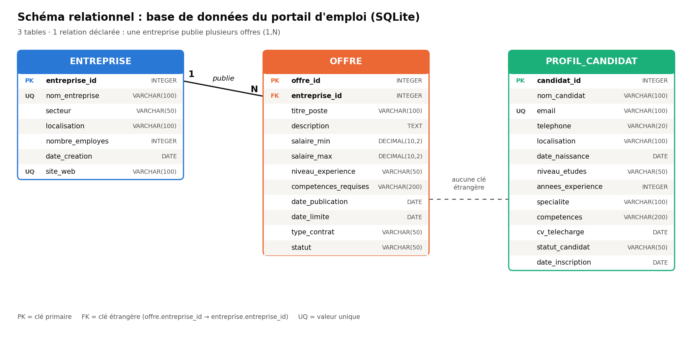

# Portail d'emploi : base SQLite et requêtes SQL

[](https://colab.research.google.com/github/anasschahide05-tech/portail-emploi-sql/blob/main/portail_emploi_sql.ipynb)

Projet de bases de données : création d'une base SQLite pour un portail d'emploi (3 tables), insertion des données, puis **5 questions SQL avec leurs réponses**. Tout est dans un seul notebook : [`portail_emploi_sql.ipynb`](portail_emploi_sql.ipynb).

## Schéma



Une relation déclarée : une entreprise publie plusieurs offres (1,N). La table `profil_candidat` n'est reliée à aucune autre table.

## Les 5 questions et leurs réponses

| Question | Réponse |
|---|---|
| 1. Nombre d'offres par entreprise (JOIN + GROUP BY) | FinanceHub 3, TechVision Maroc 3, EduTech Solutions 2, MediCare Plus 2, RetailMax 2 |
| 2. Salaire moyen par niveau d'expérience (GROUP BY + AVG) | Expert 34 000, Confirmé 23 100, Débutant 12 000 |
| 3. Candidats habitant dans une ville avec des offres ouvertes (JOIN + DISTINCT) | 13 candidats sur 15 (les 2 d'Agadir sont exclus) |
| 4. Offre au salaire maximum le plus élevé par type de contrat | CDI : Analyste Financier 40 000 ; CDD : Formateur IT 25 000 ; Stage : Stagiaire Finance 8 000 |
| 5. Secteurs des entreprises sans offre (NOT IN) | Aucun : les 5 entreprises ont au moins une offre (requête testée avec une entreprise ajoutée) |

Les requêtes, leurs résultats et les explications sont dans le notebook.

## Contenu

```
├── portail_emploi_sql.ipynb      # notebook exécuté : schéma, données, 5 questions, réponses
├── schema_portail_emploi.png     # schéma relationnel
├── data/
│   ├── entreprise.csv            # 5 entreprises
│   ├── offre.csv                 # 12 offres
│   └── profil_candidat.csv       # 15 candidats
└── README.md
```

## Exécuter

Cliquez sur le bouton Colab en haut, puis **Exécution > Tout exécuter**. En local : `pip install pandas jupyter` puis `jupyter notebook portail_emploi_sql.ipynb`.

## Auteur

Anass Chahid, Master Commerce International, ENCG Settat.
